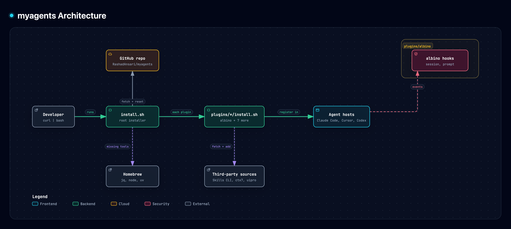

# myagents

[](https://github.com/RashadAnsari/myagents/actions/workflows/build.yml)
[](LICENSE)


**One command to give every AI coding agent you use the same memory, reviewers, and working rules.**

Coding agents start every session from zero. They forget what your team decided last week, skip the conventions in `AGENTS.md`, guess at library versions, and review code in one generic pass. myagents fixes that across Claude Code, Cursor, and Codex at once:

- **Memory that persists.** Agents look up project decisions and your preferences before they start, and save new ones when they finish. Memory follows the repository across clones and machines.
- **14 specialist reviewers.** Security, performance, architecture, tests, accessibility, database, dead code, and more. Run all of them in parallel, pick one, or point them at a GitHub pull request.
- **Rules that stay on.** Research before guessing, the simplest change that works, no filler in answers. Hooks load them at the start of every session and repeat them on every prompt, so they hold up in long conversations.
- **One install, three tools.** The installer finds the tools you have and sets up each one the way that tool expects. Rerun it to update.

---

## Quick start

On macOS, run this. It installs any missing tools it needs with Homebrew, and installs Homebrew first if you don't have it:

```bash
curl -fsSL https://raw.githubusercontent.com/RashadAnsari/myagents/master/install.sh | bash
```

```
myagents
  ✓ Download        Saved to ~/.myagents (version 65f708b).
  ✓ Requirements    All installed.
  ✓ Apps            Found Claude Code, Cursor, Codex.

agent-memory
  ✓ Claude Code     Installed. Restart open sessions to load it.
  ✓ Cursor          Installed. Run 'Developer: Reload Window' to load it.
  ✓ Codex           Installed. Restart Codex, then run /hooks once to trust its hooks.

albino
  ✓ Claude Code     Installed. Restart open sessions to load it.
  ✓ Cursor          Installed. Run 'Developer: Reload Window' to load it.
  ✓ Codex           Installed. Restart Codex, then run /hooks once to trust its hooks.

archify
  ✓ Claude Code     Installed. Restart open sessions to load it.
  ✓ Cursor          Installed. Start a new chat to load it.
  ✓ Codex           Installed. Restart Codex to load it.

context7
  ✓ Claude Code     Installed. Restart open sessions, then run /mcp once to sign in to Context7.
  ✓ Cursor          Installed. Sign in to Context7 when Cursor asks, or from Cursor Settings > MCP.
  ✓ Codex           Installed. Run 'codex mcp login context7' once to sign in.

emil-skills
  ✓ Claude Code     Installed. Restart open sessions to load it.
  ✓ Cursor          Installed. Start a new chat to load it.
  ✓ Codex           Installed. Restart Codex to load it.

ponytail
  ✓ Claude Code     Installed. Restart open sessions to load it.
  ✓ Codex           Installed. Restart Codex, then run /hooks once to trust its hooks.
  ✓ Cursor          Installed. Start a new chat to load it.

security-audit
  ✓ Claude Code     Installed. Restart open sessions to load it.
  ✓ Cursor          Installed. Start a new chat to load it.
  ✓ Codex           Installed. Restart Codex to load it.

ui-ux-pro-max
  ✓ Claude Code     Installed. Restart open sessions to load it.
  ✓ Cursor          Installed. Start a new chat to load it.
  ✓ Codex           Installed. Restart Codex to load it.

Summary
  ✓ agent-memory    Ready.
  ✓ albino          Ready.
  ✓ archify         Ready.
  ✓ context7        Ready.
  ✓ emil-skills     Ready.
  ✓ ponytail        Ready.
  ✓ security-audit  Ready.
  ✓ ui-ux-pro-max   Ready.
```

Then try it in any project:

```
/reviewcrew                       # every reviewer in parallel, report in REVIEW_REPORT.md
/audit security src/api           # one reviewer, one folder
/pr-review https://github.com/org/repo/pull/42
/remember we deploy from the release branch, never from master
```

To update, run the same install command again.

---

## Architecture



The diagram is generated with [archify](#archify) from [docs/architecture.json](docs/architecture.json). Run `make diagram` to render and export it again.

---

## Contents

- [Architecture](#architecture)
- [Plugins](#plugins): [agent-memory](#agent-memory), [albino](#albino), [archify](#archify), [context7](#context7), [emil-skills](#emil-skills), [ponytail](#ponytail), [security-audit](#security-audit), [ui-ux-pro-max](#ui-ux-pro-max)
- [Platform support](#platform-support)
- [Installing, updating, and uninstalling](#installing-updating-and-uninstalling)
- [Contributing](#contributing)
- [License](#license)

---

## Plugins

### agent-memory

[agent-memory](https://github.com/RashadAnsari/agent-memory) gives agents memory that persists across sessions. They look up project decisions and your preferences before they start, and save new ones when they finish, telling you each one in the chat. Project memory follows the repository across clones and machines; user memory applies to every project. It adds `/remember`, `/forget`, and `/enrich`, which mines recent pull requests for decisions and conventions. The albino reviewers and `/reviewcrew`, `/audit`, and `/pr-review` read from it before they review.

Memory is stored in `~/.agent-memory/memory.sqlite`, and uninstalling keeps it.

### albino

The main plugin: review agents, workflow skills such as `/reviewcrew`, `/pr-review`, and `/commit-pr`, always-on knowledge skills, session hooks, and rules. See the [albino README](plugins/albino/README.md) for the full list and how each piece works on Claude Code, Cursor, and Codex.

### archify

[Archify](https://github.com/tt-a1i/archify) by tt-a1i turns a description, a repository, or pasted Mermaid into an interactive architecture, workflow, sequence, data-flow, or state diagram. The result is one self-contained HTML file with dark and light themes, node details, and path tracing, which you can open in any browser or send to someone, and export as PNG, SVG, or video. Ask for a diagram ("map this repository's runtime architecture", "show the checkout flow") and it activates on its own; for a repository, it can link each node to the source files behind it.

When it delivers a diagram it may check for a newer release to show a reminder, and never updates itself; set `ARCHIFY_UPDATE_CHECK_DISABLED=1` to turn that check off.

### context7

[Context7](https://github.com/upstash/context7) by Upstash gives agents current, version-specific documentation for libraries and frameworks, pulled from their source repositories, so they stop guessing at APIs that changed after their training data. It pairs with albino's `research-first` skill, which tells agents to check the docs before answering; Context7 is where they read them. Ask a library question and it resolves the library, then fetches the relevant docs.

Sign in once per tool, so no API key is stored on disk: run `/mcp` in Claude Code, sign in when Cursor asks, or run `codex mcp login context7`.

### emil-skills

[Emil Kowalski's skills](https://github.com/emilkowalski/skills) teach agents the small interface details they tend to get wrong: the right easing and duration for an animation, a soft shadow instead of a hard border, motion that does not drop frames. They draw on his work at Vercel and Linear. The set covers building, reviewing, and auditing animations (`animate`, `animate-expo`, `review-animations`, `improve-animations`, `find-animation-opportunities`, `animation-performance`, `animation-vocabulary`), general design (`emil-design-eng`, `apple-design`, `mobile-native`, `break-ui`, `prototype`, `pick-ui-library`), Swift (`write-swift`), and his Sonner toast library (`ask-sonner`). They complement albino's `frontend-design` skill, which sets a visual direction, and ui-ux-pro-max, which supplies styles and palettes; these focus on motion and polish.

### ponytail

[ponytail](https://github.com/DietrichGebert/ponytail) by Dietrich Gebert is a third-party plugin that pushes agents toward the shortest solution that works: YAGNI, standard library first, no abstractions nobody asked for.

### security-audit

[security-audit](https://github.com/cloudflare/security-audit-skill) by Cloudflare is the skill that seeded Cloudflare's vulnerability discovery harness. Ask for a security audit and it runs isolated agents through reconnaissance, coverage-led hunting, and validation, where a fresh agent tries to disprove every finding, then writes a report with confirmed findings and open leads. Reports default to `~/security-audit-skill/<repo-name>/`. It complements albino's `security-reviewer`, which gives a quicker single-pass review.

Building or running the audited code needs an OS-level sandbox; without one, the skill reports those leads as unconfirmed instead of executing the target.

### ui-ux-pro-max

[UI UX Pro Max](https://github.com/nextlevelbuilder/ui-ux-pro-max-skill) by nextlevelbuilder gives agents a searchable local design database: 79 styles, 192 product palettes, 74 font pairings, 119 UX guidelines, 25 chart types, and guidance for 22 stacks, from React and SwiftUI to Flutter and Tailwind. It activates on its own when you build, review, or fix an interface, and can generate a design system for your product. It overlaps with albino's `frontend-design` skill, which sets a visual direction; this one supplies the concrete styles, palettes, and stack rules.

It ships seven skills: `ui-ux-pro-max`, `design`, `design-system`, `ui-styling` (shadcn/ui and Tailwind), `brand`, `banner-design`, and `slides`.

---

## Platform support

| | Claude Code | Cursor | Codex |
|---|:---:|:---:|:---:|
| agent-memory | ✓ | ✓ | ✓ after `/hooks` |
| albino | ✓ | ✓ | ✓ after `/hooks` |
| archify | ✓ | ✓ | ✓ |
| context7 | ✓ | ✓ | ✓ |
| emil-skills | ✓ | ✓ | ✓ |
| ponytail | ✓ | ✓ | ✓ after `/hooks` |
| security-audit | ✓ | ✓ | ✓ |
| ui-ux-pro-max | ✓ | ✓ | ✓ |

---

## Installing, updating, and uninstalling

**Installing.** Run the command from [Quick start](#quick-start). The installer downloads this repository to `~/.myagents`, installs any missing tools from [`requirements.list`](requirements.list) with Homebrew (installing Homebrew first if needed, which may ask for your password), then sets up every plugin in each of Claude Code, Cursor, and Codex that it finds. Tools you already have are left alone. `git` and `python3` come with the Xcode Command Line Tools (`xcode-select --install`).

Each line of the output says what to do next, such as restarting a tool, signing in to Context7, or running `/hooks` once in Codex to trust the hooks.

**Updating.** Run the install command again. Every step is safe to repeat: a rerun updates what is there and never duplicates settings, hooks, or links. `~/.myagents` belongs to the installer, so a rerun resets it to the latest version and discards local edits to tracked files.

**Uninstalling.** This undoes every install step on every tool, including settings, hooks, and MCP servers, then deletes `~/.myagents`. Your own settings, hooks, skills, agents, and rules are left alone, including the text in `~/.codex/AGENTS.md` outside the albino block, and so is your memory in `~/.agent-memory`. Homebrew and the tools from `requirements.list` stay installed, since other software may use them; remove them with `brew uninstall` if you no longer need them.

```bash
curl -fsSL https://raw.githubusercontent.com/RashadAnsari/myagents/master/uninstall.sh | bash
```

Rerunning the uninstaller is safe: steps with nothing left to undo report "Already removed." If a step fails, `~/.myagents` is kept so you can fix the problem and rerun.

---

## Contributing

Repository rules for contributors and agents, including how to add a plugin, are in [`AGENTS.md`](AGENTS.md). Run `make local` before opening a pull request.

---

## License

[MIT](LICENSE) © Rashad Ansari
